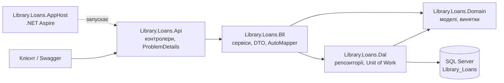
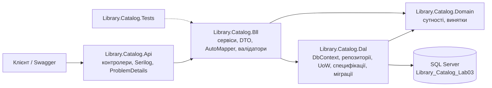

# LibraryLabs — бібліотечна мікросервісна система

## Предметна область

Бібліотека: читачі беруть книги на видачу, книги ведуться в каталозі,
читачі залишають відгуки й обговорюють книги. Система поділена на три
незалежні контексти (Database-per-Service), кожен зі своєю базою й
технологією. FOREIGN KEY між базами немає — зв'язок лише через
ідентифікатори та контрольоване дублювання даних.

| Контекст | База | Технологія | Сутності |
|---|---|---|---|
| **Loans** (Проєкт №1) | `Library_Loans` | SQL Server | Readers, Books (копія), Loans, LoanDetails, LoanItems, LoanStatusHistory |
| **Catalog** (Проєкт №2) | `Library_Catalog` | SQL Server + EF Core | Books, Authors, Publishers, Categories, BookDetails, BookAuthors |
| **Reviews** (Проєкт №3) | `Library_Reviews` | MongoDB | reviews, discussions, messages, ratings |

ERD усіх трьох контекстів: [docs/erd.md](docs/erd.md).

## Політика дублювання даних між базами

| Поле | Де зберігається | Джерело правди | Політика узгодженості |
|---|---|---|---|
| `BookId`, `Isbn`, `Title` | `Library_Loans.Books` | `Library_Catalog.Books` | локальна копія; `Isbn` — природний ключ синхронізації, `SyncedAt` фіксує момент копіювання |
| `IsAvailable` | `Library_Loans.Books` | `Library_Loans` | не дублюється з Catalog — це локальний стан видачі |
| `BookTitle` | `Library_Loans.LoanItems` | `Library_Catalog.Books.Title` | знімок на момент видачі, ретроактивно не оновлюється |
| `bookId` | `Library_Reviews.reviews`, `discussions`, `ratings` | `Library_Catalog.Books.BookId` | посилання без FK; консистентність на рівні застосунку |
| `readerId`, `readerName` | `Library_Reviews.reviews` | `Library_Loans.Readers` | `readerId` — посилання, `readerName` — знімок на момент відгуку |
| `bookTitle` | `Library_Reviews.ratings` | `Library_Catalog.Books.Title` | знімок, оновлюється разом з агрегатом рейтингу |

Модель узгодженості — eventual consistency: дублікати допускають коротке
розходження і не потребують розподілених транзакцій.

## Розгортання баз (Lab01)

Порядок запуску скриптів із папки `db/`:

1. **Library_Loans** (SSMS, база `Library_Loans`): `db/p1/schema.sql` → `db/p1/procedures.sql` → `db/p1/seed.sql`
2. **Library_Catalog** (SSMS, база `Library_Catalog`): `db/p2/schema.sql` → `db/p2/seed.sql`
3. **Library_Reviews** (mongosh, кластер Atlas): `db/p3/collections.js` → `db/p3/seed.js`

Усі seed-скрипти ідемпотентні (`IF NOT EXISTS` / `upsert`) — повторний запуск
не створює дублікатів. Порожню базу (`Library_Loans`, `Library_Catalog`)
потрібно створити вручну перед запуском `schema.sql`.

Seed-дані `db/p1` і `db/p2` узгоджені за ISBN. На чистому розгортанні
(порожні бази) `BookId` 1–4 також збігаються в обох базах; зв'язок між
сервісами в будь-якому разі тримається на `Isbn` як природному ключі.

## Lab02 — тришарова архітектура (Library.Loans.Solution)

### Схема рішення



Залежності йдуть в один бік: `Api → Bll → Dal → Domain`.

### Що потрібно для запуску

- .NET SDK 10
- SQL Server (Express) з базою `Library_Loans`, розгорнутою за розділом «Розгортання баз» вище
- Рядок підключення `ConnectionStrings:LibraryLoans` в
  `Library.Loans.AppHost/appsettings.json` (за потреби змініть сервер)

### Запуск через .NET Aspire

```
cd Library.Loans.Solution
dotnet run --project Library.Loans.AppHost
```

AppHost читає рядок підключення зі свого `appsettings.json`, реєструє його
через `AddConnectionString("LibraryLoans")` і передає в API через
`WithReference`. Aspire Dashboard відкривається за адресою
`https://localhost:17180`; там видно ресурс `loans-api`, його логи й
посилання на Swagger.

Запуск без Aspire: `dotnet run --project Library.Loans.Api` (рядок
підключення береться з `Library.Loans.Api/appsettings.json`).

### Приклади запитів

Підставте порт API з Aspire Dashboard (`<port>`).

```
# створити читача (201 + Location)
curl -X POST https://localhost:<port>/api/Readers \
  -H "Content-Type: application/json" \
  -d '{"cardNumber":"RDR-0010","fullName":"Тест Тестович","email":"test@example.com"}'

# створити видачу (201)
curl -X POST https://localhost:<port>/api/Loans \
  -H "Content-Type: application/json" \
  -d '{"readerId":1,"dueDate":"2026-12-01","bookIds":[1,2]}'

# отримати видачу з позиціями (200)
curl https://localhost:<port>/api/Loans/1

# повернути книгу (204)
curl -X POST https://localhost:<port>/api/Loans/1/return/1

# скасувати видачу (204)
curl -X POST https://localhost:<port>/api/Loans/1/cancel
```

Коди помилок (ProblemDetails): 400 — невалідний запит, 404 — не знайдено,
409 — бізнес-конфлікт (наприклад, книга вже видана, повторне повернення).

### Що реалізовано

- `IGenericRepository<T>`, `RepositoryBase`, `BaseDapperRepository<T>` — спільний CRUD для Dapper-репозиторіїв.
- `ReaderRepository` — чистий ADO.NET (`SqlCommand`/`SqlDataReader`), без generic-інтерфейсу.
- Multi-mapping JOIN (`GetWithItemsAsync`): Loan + LoanItems одним запитом.
- Unit of Work: одне з'єднання й транзакція на всі репозиторії, явний рівень ізоляції (`ReadCommitted`).
- DataAnnotations на DTO; бізнес-валідація й доменні винятки в BLL.
- Централізована обробка помилок (`IExceptionHandler` → `ProblemDetails`).
- Процедури зі статус-гардом (`UPDLOCK`) і кодами помилок 50001/50002/50003.

## Lab03 — тришарова архітектура на EF Core (Library.Catalog.Solution)

Мікросервіс **Catalog** (Проєкт №2): книги, автори, видавці, категорії. Доступ до
даних — EF Core (Code-First, Fluent API, міграції, LINQ to Entities).

### Схема рішення



Залежності: `Api → Bll → Dal → Domain`.

### Модель даних

| Сутність | Зв'язок |
|---|---|
| `Book` ↔ `BookDetail` | 1:1, PK `BookId` є водночас FK |
| `Publisher` → `Book`, `Category` → `Book` | 1:N, без каскадного видалення |
| `Book` ↔ `Author` | M:N через явну проміжну сутність `BookAuthor` зі складеним ключем `(BookId, AuthorId)` і власними полями `Role`, `AddedAt` |

- Бізнес-правила — у методах сутності `Book` (ціна перевіряється в конструкторі та `ChangePrice`, залишок змінюється лише `RemoveCopies` / `AddCopies`), setter-и приватні.
- Конфігурація кожної сутності — окремий клас `IEntityTypeConfiguration<T>` (`Library.Catalog.Dal/Configurations`), підключені централізовано через `ApplyConfigurationsFromAssembly`.
- Обмеження: `CK_Books_Price` (`Price > 0`), `CK_Books_AvailableCopies`, `CK_BookDetails_PageCount`, унікальні індекси `Books.Isbn`, `Categories.Name`, `decimal(18,2)` для ціни.

### Що потрібно для запуску

- .NET SDK 10, SQL Server (Express)
- `dotnet tool install --global dotnet-ef`
- Рядок підключення `ConnectionStrings:CatalogDb` у `Library.Catalog.Api/appsettings.json`
  (база `Library_Catalog_Lab03` створюється міграцією автоматично)

### Міграції

```
cd Library.Catalog.Solution

# створити початкову міграцію (папка Library.Catalog.Dal/Migrations)
dotnet ef migrations add InitialCreate --project Library.Catalog.Dal --startup-project Library.Catalog.Api

# застосувати до бази
dotnet ef database update --project Library.Catalog.Dal --startup-project Library.Catalog.Api

# SQL-скрипт міграції
dotnet ef migrations script --project Library.Catalog.Dal --startup-project Library.Catalog.Api -o ../sql/lab03_catalog_migration.sql
```

Під час старту API також виконує `MigrateAsync()`, тому окремий `database update` не обов'язковий.

### Запуск

```
cd Library.Catalog.Solution
dotnet run --project Library.Catalog.Api
```

Swagger: `http://localhost:5238/swagger`. Тести: `dotnet test`.

### Seeding (ідемпотентний)

- Довідники `Publishers` і `Categories` — статично через `HasData` із фіксованими Id (потрапляють у міграцію).
- Автори, книги, деталі й зв'язки — програмно (`DbInitializer.SeedAsync`) після `MigrateAsync()` з перевіркою `AnyAsync` перед вставкою: повторний запуск не дублює дані.
- Вимикається в Production і параметром `Seeding:Enabled=false`.

### Репозиторії та Unit of Work

| Репозиторій | Що демонструє | SQL-запитів |
|---|---|---|
| `BookRepository.GetWithDetailsAsync` | Eager Loading: `Include` / `ThenInclude` | 1 |
| `AuthorRepository.GetWithBooksAsync` | Explicit Loading: `Entry().Collection().Query().LoadAsync()` | 2 |
| `BookAuthorRepository.GetBooksByAuthorAddedAfterAsync` | LINQ to Entities через проміжну сутність і поле `AddedAt` | 1 |

`GenericRepository<T>` (`AddAsync`, `GetByIdAsync`, `GetAllAsync`, `Update`, `Delete`, `ListAsync(spec)`, `CountAsync(spec)`)
не зберігає зміни сам: `Update`/`Delete` лише змінюють стан у контексті, а єдиний
`SaveChangesAsync()` викликається в `UnitOfWork` один раз наприкінці бізнес-операції.

### Специфікації

Критерії вибірки (`Where`, `Include`, `OrderBy`, `Skip/Take`) описані в класах
`Specification<T>` (`Library.Catalog.Dal/Specifications`) окремо від репозиторію;
репозиторій лише застосовує їх через `WithSpecification(spec)`.
Реалізовано власну версію шаблону за принципом Ardalis.Specification.

- `BooksFilterSpec` — фільтри, сортування, пагінація списку книг;
- `BooksByCategorySpec` — інші критерії, проходить через той самий `ListAsync` без змін у репозиторії.

### API

| Метод і шлях | Призначення | Коди |
|---|---|---|
| `GET /api/books?page=&pageSize=&search=&minPrice=&maxPrice=&categoryId=&publisherId=&sortBy=&sortDir=` | список із пагінацією | 200, 400 |
| `GET /api/books/{id}` | картка книги (Eager) | 200, 404 |
| `POST /api/books` | створити книгу | 201 + Location, 400, 404, 409 |
| `PUT /api/books/{id}/price` | змінити ціну | 204, 400, 404 |
| `POST /api/books/{id}/write-off` | списати примірники | 204, 400, 404, 409 |
| `DELETE /api/books/{id}` | видалити | 204, 404 |
| `GET /api/authors/{id}` | автор із книгами (Explicit) | 200, 404 |
| `GET /api/authors/{id}/books?addedAfter=` | книги автора, додані після дати (M:N) | 200, 404 |
| `GET /api/categories/{id}/books` | книги категорії (друга специфікація) | 200, 404 |

Пагінація: `sortBy` ∈ `title | price | isbn | copies`, `sortDir` ∈ `asc | desc`, `pageSize` обмежено 100.
Відповідь: `items`, `totalCount`, `page`, `pageSize`, `totalPages`, `hasNext`, `hasPrevious`;
`Where`, `OrderBy` і `Skip/Take` виконуються в SQL до `ToListAsync()`, `totalCount` — окремий `COUNT(*)`.

```
curl "http://localhost:5238/api/books?page=2&pageSize=5&sortBy=price&sortDir=desc"

curl -X POST http://localhost:5238/api/books -H "Content-Type: application/json" -d '{
  "isbn":"978-966-03-0099-1","title":"Нова книга","price":199.9,"availableCopies":3,
  "publisherId":1,"categoryId":2,"annotation":"Опис","pageCount":120,"language":"uk",
  "authors":[{"authorId":1,"role":"Author"}]}'
```

### Валідація й помилки

- Прості правила — DataAnnotations на DTO (`[Required]`, `[StringLength]`); складні — валідатори FluentValidation (`Library.Catalog.Bll/Validators`), зареєстровані через `AddValidatorsFromAssemblyContaining` і викликані явно через `IValidator<T>` (без застарілого `AddFluentValidation`). Правила не дублюються.
- Некоректні дані → `400` `ValidationProblemDetails` з переліком помилок по полях; відсутній ресурс → `404`; конфлікт (дубль ISBN, порушення правила сутності) → `409`; усе — у форматі `ProblemDetails`.
- `GlobalExceptionHandler` (`IExceptionHandler`): `EntityNotFoundException` → 404, `ValidationException` → 400, `ConflictException` і `DomainException` → 409; кожен виняток логується один раз, деталі 500-х — лише в Development.

### Логування

Serilog (console + файл `logs/catalog-.log`), структуровані властивості `CorrelationId`
(заголовок `X-Correlation-ID`), `UserId`, `RequestPath`. Для
`Microsoft.EntityFrameworkCore.Database.Command` рівень `Information`, тому в лозі видно SQL:
eager-запит картки книги — один `SELECT ... JOIN`, explicit-завантаження автора з книгами — два окремі `SELECT`.
