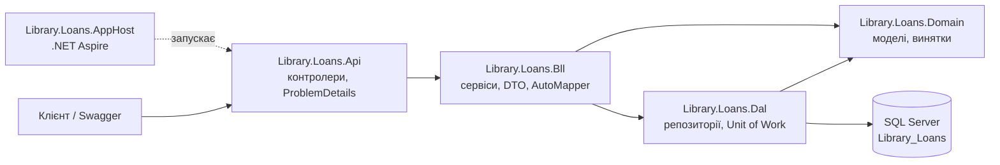

# LibraryLabs — бібліотечна мікросервісна система

## Предметна область

Бібліотека: читачі беруть книги на видачу, книги ведуться в каталозі,
читачі залишають відгуки й обговорюють книги. Система поділена на три
незалежні контексти (Database-per-Service), кожен зі своєю базою й
технологією. FOREIGN KEY між базами немає — зв'язок лише через
ідентифікатори та контрольоване дублювання даних.

| Контекст | База | Технологія | Сутності |
|---|---|---|---|
| **Loans** (Проєкт №1) | `Library_Loans` | SQL Server | Readers, Books (копія), Loans, LoanDetails, LoanItems, LoanStatusHistory |
| **Catalog** (Проєкт №2) | `Library_Catalog` | SQL Server + EF Core | Books, Authors, Publishers, Categories, BookDetails, BookAuthors |
| **Reviews** (Проєкт №3) | `Library_Reviews` | MongoDB | reviews, discussions, messages, ratings |

ERD усіх трьох контекстів: [docs/erd.md](docs/erd.md).

## Політика дублювання даних між базами

| Поле | Де зберігається | Джерело правди | Політика узгодженості |
|---|---|---|---|
| `BookId`, `Isbn`, `Title` | `Library_Loans.Books` | `Library_Catalog.Books` | локальна копія; `Isbn` — природний ключ синхронізації, `SyncedAt` фіксує момент копіювання |
| `IsAvailable` | `Library_Loans.Books` | `Library_Loans` | не дублюється з Catalog — це локальний стан видачі |
| `BookTitle` | `Library_Loans.LoanItems` | `Library_Catalog.Books.Title` | знімок на момент видачі, ретроактивно не оновлюється |
| `bookId` | `Library_Reviews.reviews`, `discussions`, `ratings` | `Library_Catalog.Books.BookId` | посилання без FK; консистентність на рівні застосунку |
| `readerId`, `readerName` | `Library_Reviews.reviews` | `Library_Loans.Readers` | `readerId` — посилання, `readerName` — знімок на момент відгуку |
| `bookTitle` | `Library_Reviews.ratings` | `Library_Catalog.Books.Title` | знімок, оновлюється разом з агрегатом рейтингу |

Модель узгодженості — eventual consistency: дублікати допускають коротке
розходження і не потребують розподілених транзакцій.

## Розгортання баз (Lab01)

Порядок запуску скриптів із папки `db/`:

1. **Library_Loans** (SSMS, база `Library_Loans`): `db/p1/schema.sql` → `db/p1/procedures.sql` → `db/p1/seed.sql`
2. **Library_Catalog** (SSMS, база `Library_Catalog`): `db/p2/schema.sql` → `db/p2/seed.sql`
3. **Library_Reviews** (mongosh, кластер Atlas): `db/p3/collections.js` → `db/p3/seed.js`

Усі seed-скрипти ідемпотентні (`IF NOT EXISTS` / `upsert`) — повторний запуск
не створює дублікатів. Порожню базу (`Library_Loans`, `Library_Catalog`)
потрібно створити вручну перед запуском `schema.sql`.

Seed-дані `db/p1` і `db/p2` узгоджені за ISBN. На чистому розгортанні
(порожні бази) `BookId` 1–4 також збігаються в обох базах; зв'язок між
сервісами в будь-якому разі тримається на `Isbn` як природному ключі.

## Lab02 — тришарова архітектура (Library.Loans.Solution)

### Схема рішення



Залежності йдуть в один бік: `Api → Bll → Dal → Domain`.

### Що потрібно для запуску

- .NET SDK 10
- SQL Server (Express) з базою `Library_Loans`, розгорнутою за розділом «Розгортання баз» вище
- Рядок підключення `ConnectionStrings:LibraryLoans` в
  `Library.Loans.AppHost/appsettings.json` (за потреби змініть сервер)

### Запуск через .NET Aspire

```
cd Library.Loans.Solution
dotnet run --project Library.Loans.AppHost
```

AppHost читає рядок підключення зі свого `appsettings.json`, реєструє його
через `AddConnectionString("LibraryLoans")` і передає в API через
`WithReference`. Aspire Dashboard відкривається за адресою
`https://localhost:17180`; там видно ресурс `loans-api`, його логи й
посилання на Swagger.

Запуск без Aspire: `dotnet run --project Library.Loans.Api` (рядок
підключення береться з `Library.Loans.Api/appsettings.json`).

### Приклади запитів

Підставте порт API з Aspire Dashboard (`<port>`).

```
# створити читача (201 + Location)
curl -X POST https://localhost:<port>/api/Readers \
  -H "Content-Type: application/json" \
  -d '{"cardNumber":"RDR-0010","fullName":"Тест Тестович","email":"test@example.com"}'

# створити видачу (201)
curl -X POST https://localhost:<port>/api/Loans \
  -H "Content-Type: application/json" \
  -d '{"readerId":1,"dueDate":"2026-12-01","bookIds":[1,2]}'

# отримати видачу з позиціями (200)
curl https://localhost:<port>/api/Loans/1

# повернути книгу (204)
curl -X POST https://localhost:<port>/api/Loans/1/return/1

# скасувати видачу (204)
curl -X POST https://localhost:<port>/api/Loans/1/cancel
```

Коди помилок (ProblemDetails): 400 — невалідний запит, 404 — не знайдено,
409 — бізнес-конфлікт (наприклад, книга вже видана, повторне повернення).

### Що реалізовано

- `IGenericRepository<T>`, `RepositoryBase`, `BaseDapperRepository<T>` — спільний CRUD для Dapper-репозиторіїв.
- `ReaderRepository` — чистий ADO.NET (`SqlCommand`/`SqlDataReader`), без generic-інтерфейсу.
- Multi-mapping JOIN (`GetWithItemsAsync`): Loan + LoanItems одним запитом.
- Unit of Work: одне з'єднання й транзакція на всі репозиторії, явний рівень ізоляції (`ReadCommitted`).
- DataAnnotations на DTO; бізнес-валідація й доменні винятки в BLL.
- Централізована обробка помилок (`IExceptionHandler` → `ProblemDetails`).
- Процедури зі статус-гардом (`UPDLOCK`) і кодами помилок 50001/50002/50003.
