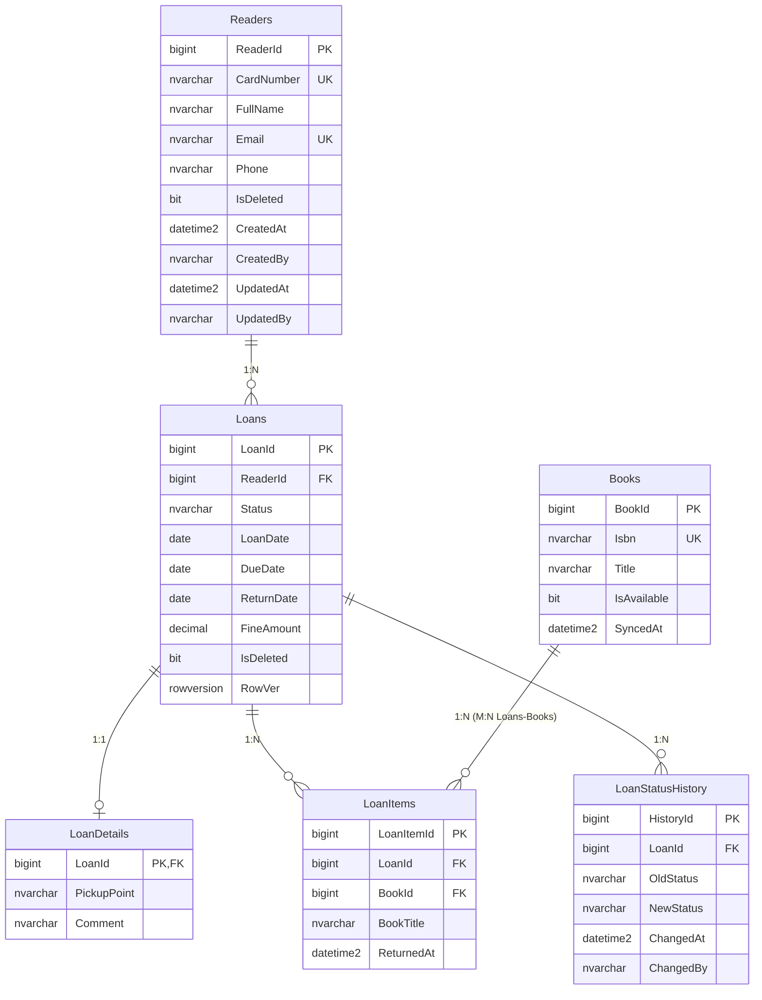
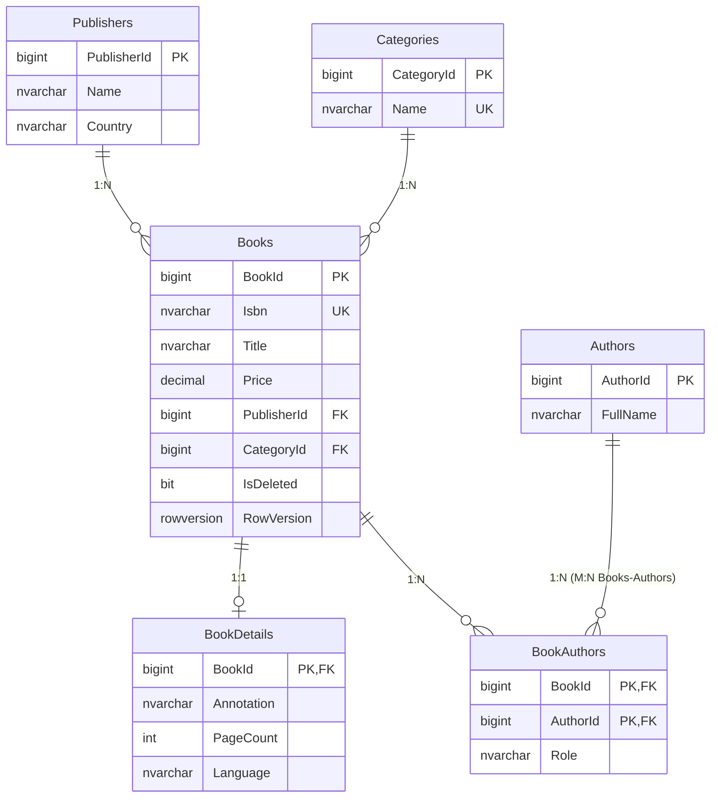

# ERD та опис контекстів

Предметна область — бібліотека. Система розбита на три незалежні bounded
contexts (кожен — окремий сервіс зі своєю базою; FOREIGN KEY між базами немає).

## 1. Loans (Library_Loans, SQL Server) — видачі

Відповідає за читачів і видачі книг. Книги тут — лише локальна копія
(BookId/Isbn/Title) з Catalog, плюс локальний стан `IsAvailable`.



Зв'язки: Readers–Loans 1:N; Loans–LoanDetails 1:1; Loans–Books M:N через
LoanItems (власні поля `BookTitle`, `ReturnedAt`); Loans–LoanStatusHistory 1:N.

## 2. Catalog (Library_Catalog, SQL Server + EF Core) — каталог

Джерело правди про книги, авторів, видавців і категорії.



Зв'язки: Publishers–Books 1:N; Categories–Books 1:N; Books–BookDetails 1:1;
Books–Authors M:N через BookAuthors (власне поле `Role`).

## 3. Reviews (Library_Reviews, MongoDB) — відгуки й обговорення

| Колекція | Підхід | Опис |
|---|---|---|
| `discussions` | referencing | `messageIds` — масив ObjectId-посилань на документи `messages` |
| `messages` | — | окремі повідомлення, на які посилаються обговорення (`authorId`, `text`) |
| `reviews` | гібридний + embedding | `bookId`/`readerId` — посилання, `readerName` продубльовано; у деяких документах вкладені масиви `comments`, `tags` |
| `ratings` | гібридний знімок | агрегат на книгу (`bookId`, продубльована `bookTitle`, `avgRating`, `totalReviews`) |

Гнучка схема: документи в `reviews` мають різні набори полів (`photoUrl`,
`verifiedPurchase`, `comments`, `tags` — лише там, де потрібні).

Приклад документа `reviews`:

```json
{
  "bookId": 103,
  "readerId": 90,
  "readerName": "Ірина Бойко",
  "rating": 4,
  "text": "Гарне видання, ілюстрації чудові.",
  "createdAt": "2026-09-24T16:44:56.966Z",
  "photoUrl": "https://example.com/photos/book103.jpg",
  "verifiedPurchase": true
}
```
